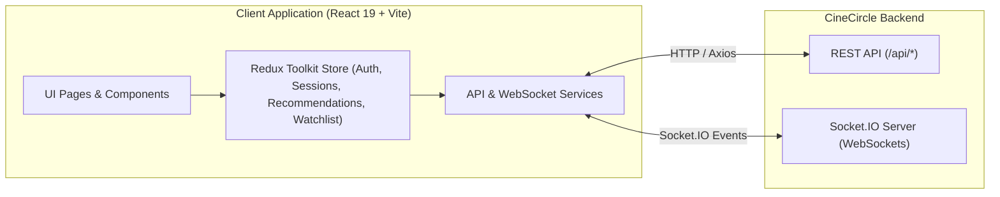

# CineCircle Web Client (`cinecircle-fe`)

> Fast, responsive, cinematic single-page application for **CineCircle** — A Social Watch-Decision & Review Platform.

---

## 1. Overview & UI/UX Philosophy

**CineCircle** is built with **React 19, TypeScript, and Vite**, styled using **Tailwind CSS v4** with a modern dark theme inspired by Netflix and Letterboxd.

### Design Principles:
- **Review & Decision First**: Positioned cleanly as a social community and decision-layer — not a video streaming provider.
- **Cinematic Atmosphere**: Ambient glow effects, full-screen collage backgrounds, and high-resolution TMDB backdrops and posters.
- **Adaptive Layout**: Mobile floating bottom dock with quick actions; collapsible desktop sidebar navigation for high productivity.
- **Low Latency & Real-Time Sync**: Instant UI updates powered by Redux Toolkit and duplex WebSockets via Socket.IO for watch room voting.
- **Instagram-Style Social Feed**: Community reviews with embedded polls, like/unlike toggling, who-liked-who visibility, reply threads, and member profiles.



---

## 2. User Journey & Feature Workflows

### 2.1 Landing & Community Discovery (`/`)
- **Cinematic Billboard**: Highlights the current community pick with synopsis, runtime, rating, and genre tags.
- **Landscape Trending Rail**: Horizontal swipeable carousel with 16:9 backdrop cards showing top trending movies and series.
- **"How It Works" Guide**: 3-step walkthrough explaining rating, reviews, and group decision voting.
- **Live Community Review Feed**: Real reviews from community members with spoiler protection filters.

### 2.2 Cinematic Authentication (`/login`, `/register`)
- **Full-Screen TV Collage Backdrop**: Atmospheric, immersive poster background overlay with dark gradient filters.
- **Dual Verification Modes**:
  1. Traditional **Password Login** (instant access with remember state).
  2. Passwordless **Email OTP** (delivers a 6-digit verification code directly to user's inbox via Brevo SMTP).
- **Email Verification Stepper**: Registration enforces a two-step flow (Details ➔ Email OTP confirmation) before account creation.

### 2.3 CineTaste Matrix Onboarding (`/onboarding`)
- **Step 1 - Genre Preferences**: Interactive multi-select pills for Drama, Sci-Fi, Thriller, Comedy, Romance, etc.
- **Step 2 - Seed Titles**: Select iconic benchmark films to immediately train the recommendation engine.
- **Step 3 - Streaming Passes**: Select personal subscriptions (Netflix, Prime Video, Disney+, Apple TV+, HBO Max) to eliminate unstreamable title suggestions.

### 2.4 Solo Decision Engine (`/recommend`)
- Eliminates "scrolling paralysis" in under 30 seconds.
- Contextual input controls:
  - **Available Time**: Sliders (e.g., `< 90 mins`, `< 120 mins`, or any runtime).
  - **Target Mood**: Quick selectors (*Gripping*, *Mind-Bending*, *Comfort*, *Fun*, *Stunning*).
  - **Provider Filter**: Restrict to owned streaming subscriptions.
- Delivers an instant 3-card candidate shortlist with synopsis, match rationale, and cast information.
- Interactive response buttons: **Watch Now** (saves to watchlist), **Rate**, or **Skip** (updates fatigue counter).

### 2.5 Real-Time Group Watch Rooms (`/group`)
- **Multiplayer Consensus**: Settle the "what should we watch?" debate with friends.
- **Room Creation**: Generate a 6-character room code (e.g. `SCI890`).
- **Live Attendee Sync**: See friends join in real-time via WebSockets.
- **Candidate Shortlist & Voting**:
  - Add titles dynamically from TMDB.
  - Swipe or vote with reaction strength (1 to 5 stars).
  - Live progress bars update across all connected devices simultaneously.
- **Winner Reveal**: The weighted compromise algorithm declares the fairest pick, complete with a witty **Gemini AI compromise pitch**.

### 2.6 Enthusiast Detail Hub (`/title/:id`)
- Deep title metadata from TMDB: synopsis, certification, release year, runtime, and director.
- **Streaming Availability**: Badges displaying where the title can be streamed, rented, or bought.
- **Season & Episode Guide**: Episode-by-episode summaries, still images, and air dates.
- **Curated Soundtracks**: List of key musical tracks with artist details and Spotify/preview playback links.
- **Community Discussion**: Threaded user reviews, star ratings, emoji reactions, and toggleable spoiler shields.
- **Embedded Polls**: Community polls attached to reviews with vote tracking — users see which option they voted for ("Your vote"), and each user can vote once per poll.

### 2.7 Social Feed (`/`)
- **Community Review Feed**: Real reviews from community members displayed in Instagram-style cards.
- **Like Toggle**: Heart button to like/unlike comments; heart turns red when liked, persists on refresh.
- **Who Liked**: Click the like count to see which members liked a comment.
- **Who Replied**: Click the comment count to see replies to a comment.
- **Poll Voting**: Vote on community polls directly from feed cards with visual confirmation of your vote.

### 2.8 Member Search & Profiles
- **Search Bar**: Search members by name, email, or handle from the Navbar.
- **Member Search Results**: Displayed with avatar, handle, watched count, follow status, and compatibility score.
- **Member Profiles**: Instagram-style profile page showing:
  - Avatar, name, handle, bio, and subscribed streaming passes.
  - Watched count, connection count, reviews count, circles count.
  - Watched titles grid, watchlist grid, recent reviews, active circles.
  - Taste compatibility matrix between viewer and profile owner.
  - Follow/Connect buttons and mutual-watched title indicators.

### 2.9 Watchlist & Member Profile (`/watchlist`, `/profile`)
- **Organized Watchlist**: Toggle between *To Watch* and *Watched* tabs with sorting.
- **Star Rating Modal**: Instant 1–10 star rating assignment with optional public review.
- **Taste Compatibility %**: Profile shows calculated match percentage and shared titles between any two members.
- **Social Graph**: Follow other film enthusiasts to curate your home activity feed.

---

## 3. Technology Stack

| Category | Technology | Version | Purpose |
| :--- | :--- | :--- | :--- |
| **Framework** | React | 19.x | Modern UI library with concurrent rendering |
| **Build Tool** | Vite | 8.x | Lightning-fast HMR and optimized production bundles |
| **Language** | TypeScript | 5.x / 6.x | End-to-end type safety |
| **Styling** | Tailwind CSS | 4.x (`@tailwindcss/vite`) | Utility-first styling with custom dark theme tokens |
| **State Management** | Redux Toolkit | 2.x | Centralized global store with async thunks |
| **Routing** | React Router | 7.x (`react-router-dom`) | Declarative client-side routing & route guards |
| **Real-Time** | Socket.IO Client | 4.x | WebSocket client for live watch room synchronization |
| **HTTP Client** | Axios | 1.x | REST requests with `withCredentials` so the HttpOnly session cookie is sent |
| **Icons** | Lucide React | 1.x | Clean, consistent SVG iconography |
| **Linter** | Oxlint | Latest | High-speed Rust-based JavaScript/TypeScript linter |

---

## 4. Project Structure

```text
cinecircle-fe/
├── public/
│   ├── auth-bg.jpg              # Cinematic TV series collage background
│   ├── logo.png                 # CineCircle branding mark
│   └── favicon.png
├── src/
│   ├── assets/                  # SVG icons and static graphics
│   ├── components/
│   │   ├── common/              # Navbar, Footer, BottomNav, TitlePoster, StreamingBadge
│   │   │   ├── Navbar.tsx               # Search bar with title + member search, user menu
│   │   │   └── social/
│   │   │       ├── SocialFeedPost.tsx         # Feed cards with polls, likes, likers, replies
│   │   │       ├── GroupSessionCard.tsx
│   │   │       ├── StreamingBadge.tsx
│   │   │       ├── NotificationsDropdown.tsx
│   │   │       └── ...
│   │   ├── layout/              # MainLayout with responsive sidebars & docks
│   │   ├── onboarding/          # CineTaste Matrix wizard components
│   │   └── social/              # Feed post cards, group session cards, sidebars
│   ├── hooks/                   # Custom typed hooks (`useAppDispatch`, `useAppSelector`)
│   ├── pages/                   # Application views
│   │   ├── HomePage.tsx               # Feed, hero, trending rails & social feed
│   │   ├── LoginPage.tsx              # Full-screen Netflix-style login (Password + OTP)
│   │   ├── RegisterPage.tsx           # Full-screen 2-step registration (Info + OTP)
│   │   ├── SoloRecommendationPage.tsx # Contextual decision engine
│   │   ├── GroupSessionPage.tsx       # Live watch party & voting room
│   │   ├── TitleDetailPage.tsx        # Enthusiast hub, soundtracks, discussions & polls
│   │   ├── WatchlistPage.tsx          # Saved titles and rating manager
│   │   ├── ProfilePage.tsx            # Member profile, mutuals & compatibility
│   │   ├── OnboardingPage.tsx         # Taste calibration wizard
│   │   ├── CuratorDashboardPage.tsx   # Admin synchronization & moderation
│   │   └── NotFoundPage.tsx           # 404 error page
│   ├── routes/                  # AppRoutes, ProtectedRoute & GuestRoute
│   ├── services/                # Axios API services, request cache, and Socket client
│   │   ├── api.ts
│   │   ├── auth.service.ts
│   │   ├── session.service.ts
│   │   ├── title.service.ts       # toggleLike, getCommentLikers, voteCommentPoll
│   │   ├── user.service.ts        # searchPeople, getProfile, toggleFollow
│   │   └── socket.ts
│   ├── store/                   # Redux Toolkit store & feature slices
│   │   ├── slices/
│   │   │   ├── authSlice.ts
│   │   │   ├── sessionSlice.ts
│   │   │   ├── recommendationSlice.ts
│   │   │   └── watchlistSlice.ts
│   │   └── index.ts
│   ├── types/                   # TypeScript entity models and API response types
│   ├── App.tsx                  # Root application component with Providers
│   ├── index.css                # Tailwind CSS v4 styling & design variables
│   └── main.tsx                 # DOM bootstrap entry point
├── .env.example                 # Template for client environment variables
├── package.json
├── tsconfig.json
└── vite.config.ts
```

---

## 5. Environment Variables & Setup

### 5.1 Environment Configuration

Create a `.env` file in the `cinecircle-fe` directory:

```env
# Backend API Base URL
VITE_API_BASE_URL=http://localhost:5000/api

# Real-time WebSocket Server URL
VITE_SOCKET_URL=http://localhost:5000

# Nothing else is required. The session JWT is an HttpOnly cookie set by the
# API, and avatar uploads go through POST /api/users/avatar. No token and no
# Supabase key is ever exposed to frontend code.
```

> **Auth note:** every request uses `withCredentials: true`, so the browser
> stores and sends the HttpOnly `cinecircle_token` cookie. Page JavaScript
> cannot read it, which removes the usual XSS token-theft path. In production
> the cookie is `SameSite=None; Secure` because the client and API are on
> different sites; in local development it is `SameSite=Lax`.

### 5.2 Development & Build Commands

1. **Install dependencies**:
   ```bash
   npm install
   ```

2. **Start development server** (runs on `http://localhost:5173`):
   ```bash
   npm run dev
   ```

3. **Type check and build for production**:
   ```bash
   npm run build
   ```

4. **Preview production build locally**:
   ```bash
   npm run preview
   ```

5. **Lint codebase**:
   ```bash
   npm run lint
   ```

---

## 6. Key Application Routes

| Path | Access Level | Description |
| :--- | :--- | :--- |
| `/` | Public | Discovery landing, trending carousels & social feed with reviews & polls |
| `/login` | Guest Only | Cinematic login (Password / Email OTP) |
| `/register` | Guest Only | 2-step registration with email verification |
| `/onboarding` | Protected | CineTaste Matrix taste calibration wizard |
| `/recommend` | Public / Member | Solo Decision Engine for time & mood shortlist |
| `/group` | Public / Member | Live watch room creation, join code, & consensus voting |
| `/title/:id` | Public | Movie/show metadata, soundtracks, episodes & discussion with polls |
| `/watchlist` | Protected | Personal watchlist, star ratings & watched history |
| `/profile/:id` | Public / Member | Member profile, compatibility % & mutual titles |
| `/curator` | Admin Only | Protected title catalogue sync & comment moderation |

---

## 7. Frontend-Backend API Integration

| Feature | Frontend Service | Backend Endpoint | Redux State |
| :--- | :--- | :--- | :--- |
| Auth | `auth.service.ts` | `POST /api/auth/*` | `authSlice` |
| Feed (with polls & likes) | `title.service.ts` | `GET /api/titles/feed` | `recommendationSlice` |
| Like toggle | `title.service.ts` | `POST /api/comments/:id/like` | Local component state |
| Likers list | `title.service.ts` | `GET /api/comments/:id/likers` | Local component state |
| Comment replies | `title.service.ts` | `GET /api/comments/:id/replies` | Local component state |
| Poll vote | `title.service.ts` | `POST /api/comments/:id/poll/vote` | Local component state |
| Member search | `user.service.ts` | `GET /api/users/search?q=` | Local component state |
| User profile | `user.service.ts` | `GET /api/users/:id/profile` | Local component state |
| Follow toggle | `user.service.ts` | `POST /api/users/:id/follow` | Local component state |
| Watchlist | `title.service.ts` | `GET/POST /api/watchlist` | `watchlistSlice` |
| Sessions | `session.service.ts` | `POST/GET /api/sessions/*` | `sessionSlice` |
| Socket events | `socket.ts` | WebSocket `/api/sessions/*` | `sessionSlice` |